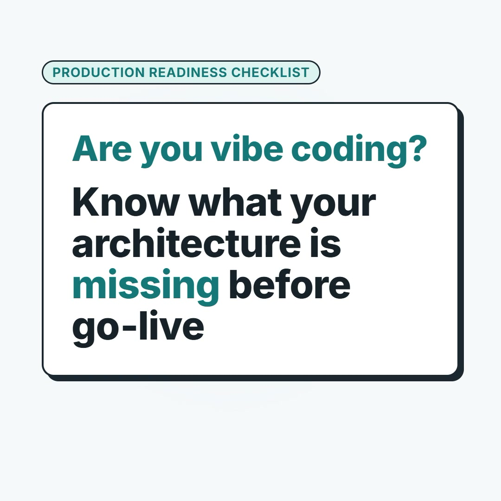

# Production Readiness Checklist

**[Open the checklist](https://marwantareks.github.io/production-checklist/)** (free, no sign-up, works offline once loaded)

[](docs/media/brag.mp4)


https://github.com/user-attachments/assets/031663bf-a174-4ba6-bbe5-005b6a63c7f3


*30-second intro. Select the image to watch the video.*

A checklist of 115 production concerns, in 10 categories, for architects and architecture review boards. It helps you find what is missing between "it works" and "it is ready for real users".

## Why this exists

Most production failures don’t come from the risks you were already worried about. They come from the questions nobody thought to ask. This checklist puts those questions in front of you before launch, so you find the gaps in a design review and not in an incident.

## What you get

- **Fewer surprises after launch.** Work through the concerns before go-live and catch the gaps early.
- **Better conversations.** Each concern has a plain-language definition, a review question, a trade-off, red flags, what good looks like, and where it shows up in a real application. You get the words to explain why something is, or isn’t, being done.
- **A common language for your team.** Every concern has a permanent number. “Concern 11” means the same thing in a design review, a decision record or a post-mortem, today and a year from now.
- **Nothing to set up.** It is one HTML file with light and dark themes. Open it in a browser, work offline, email it to a colleague or host it anywhere. There is nothing to install, nothing to sign up for and no external requests.
- **No agenda.** It is free, MIT licensed and vendor neutral. It does not recommend products.

## What makes it different

Most checklists are lists you read and tick off from memory. This one can also look at your actual project.

You can use it two ways:

- **Browse.** Open the page, walk the categories, and mark each concern decided, deferred, missing or not applicable. Your progress is saved in your browser.
- **Agent review.** Generate a prompt for [Claude Code](https://claude.com/claude-code), run it against your repository, and paste the findings back into the page. Each concern then shows what the agent found, with the evidence. You make the call.

You can trust what comes back because of how the review is set up:

- **It is read-only by design.** The prompt tells the agent to work in plan mode, never run your code, never connect to a database or service, and never print secrets.
- **It shows its evidence.** Every finding points to a file, a line and a short quote. If the agent can’t tell, it says `cannot_determine` and doesn’t guess. It only says `not_applicable` when it has found positive evidence.
- **It treats your repository as data.** Text in your code or docs is not taken as instructions.
- **Your findings stay in your tab.** They are kept in your browser for that tab only and are gone when you close it, because findings can quote private code.

Run agent review only on a repository you trust, or on a throwaway copy. See [docs/AGENT_REVIEW.md](docs/AGENT_REVIEW.md) for the safety model and its limits.

## An honest note

> **Status.** The content has been reviewed by two AI reviewers over eight rounds, and every decision is recorded in [review/decisions/](review/decisions/). It has **not** yet had review by human experts, and the agent search hints have not been tuned against many real repositories. Use it as a strong prompt for your own judgment, not as the final word.
>
> If you have expertise in security, data consistency or recovery and would like to help, see [review/EXPERT_REVIEW_PLAN.md](review/EXPERT_REVIEW_PLAN.md). The process is described in [docs/REVIEW_PROCESS.md](docs/REVIEW_PROCESS.md), and the history is in [review/LOG.md](review/LOG.md).

## Contributing

Corrections and new concerns are welcome. Start with [CONTRIBUTING.md](CONTRIBUTING.md). To report unsafe advice or a security problem in the page, see [SECURITY.md](SECURITY.md).

## License

[MIT](LICENSE). Copyright (c) 2026 Marwan Tarek.

---

# For contributors

Everything below is for people who want to build the page locally or change it. You don’t need any of it to use the checklist.

## Quick start

Requires Node.js 22 or later.

```sh
npm ci             # install dependencies, once
npm run build      # write dist/index.html
```

Then open `dist/index.html` in a browser: `open dist/index.html` on macOS, `start dist\index.html` on Windows, `xdg-open dist/index.html` on Linux.

`npm run check` validates the content, builds the page and runs the tests in one step. Run it before every commit.

To host it yourself, copy `dist/index.html` to any static web host. It has no other files.

## Building the page

`npm run build` reads `content/`, `src/template.html`, `src/styles.css`, `src/lib/prompt.js` and `src/app.js`, and inlines them all into one file, `dist/index.html`. It creates `dist/` if it is missing. The build fails if a `{{PLACEHOLDER}}` in the template is left unreplaced.

1. Edit the source: a concern in `content/concerns/`, or the page in `src/`.
2. Run `npm run check`. It validates, rebuilds and tests.
3. Reload `dist/index.html` in your browser.

`dist/` is generated and not committed, so a fresh clone has no `dist/` until you build. Never edit it by hand, because the next build overwrites it. `npm run prompts` also writes the Claude Code prompts to `dist/prompts/`.

## Commands

| Command | What it does |
| --- | --- |
| `npm run validate` | Checks every content file against the schema and the style rules. |
| `npm run build` | Builds `dist/index.html`. |
| `npm test` | Runs the content, page and review tests. |
| `npm run test:e2e` | Runs the browser layout tests. Needs Chromium. See below. |
| `npm run prompts` | Writes the Claude Code prompts to `dist/prompts/`. |
| `npm run review:export` | Builds the review pack in `review/pack/` for a third-party reviewer. |
| `npm run review:apply -- <file>` | Turns a reviewer’s findings into a report of suggested edits. |
| `npm run check` | Validate, build and test in one step. |

For the browser tests, set `CHROMIUM_PATH` to an existing Chromium, or run `npx playwright-core install chromium` once.

## Repository layout

```
content/
  categories.yaml        the ten categories, their order and icons
  meta.yaml              site title, canonical URL, year, last updated
  concerns/              one YAML file per concern (the source of truth)
schema/                  JSON Schemas for content, agent findings and review findings
src/
  template.html          page structure
  styles.css             styles, light and dark
  app.js                 page behavior
  lib/prompt.js          builds the agent prompt (used in the page and in Node)
scripts/                 validate, build, prompts, review pack, apply review
tests/                   content, page and review tests, plus browser layout tests
review/                  reviewer prompt and example; generated packs and reports go here
docs/                    schema reference, style guide, agent review, review process, architecture
.claude/skills/          Claude Code skills for adding and reviewing content
CLAUDE.md                project instructions for Claude Code
```

`dist/` and the generated review files are not committed.

## Editing content

Edit the YAML in `content/concerns/`, then run `npm run check` to rebuild. The fields are described in [docs/SCHEMA.md](docs/SCHEMA.md) and the writing rules are in [docs/CONTENT_STYLE_GUIDE.md](docs/CONTENT_STYLE_GUIDE.md). For how the pieces fit together, see [docs/ARCHITECTURE.md](docs/ARCHITECTURE.md).

## How the agent prompt is built

The page builds one prompt per scope from the same content you read, using `src/lib/prompt.js`. The same file is used by `npm run prompts`, so the page and the exported prompts can’t drift apart. The prompt rules are covered by tests, and a safety rule must never be removed to make a test pass. The agent returns JSON that the page validates on import and again on load, masks secrets in, and shows as text, never as HTML.

## Review by a third party

`npm run review:prompt -- --ids 109,110` builds one self-contained review prompt for a group of concerns. `npm run review:export` writes a pack with the content as Markdown, the generated prompts, a reviewer prompt and the schema for the reply. `npm run review:apply` turns the reply into a report you can accept or reject item by item. See [docs/REVIEW_PROCESS.md](docs/REVIEW_PROCESS.md).
